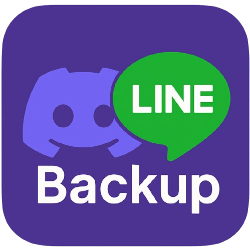

<div align="center">
  
  <h1 id="Line-Backup-To-Discord">
    <a href="https://github.com/HappyGroupHub/Line-Backup-To-Discord/" target="_blank">LINE ➵ Discord 訊息備份機器人</a>
  </h1>

[](https://github.com/HappyGroupHub/Line-Backup-To-Discord/releases)
[](https://github.com/HappyGroupHub/Line-Backup-To-Discord/releases)
[](https://github.com/HappyGroupHub/Line-Backup-To-Discord/blob/master/LICENSE)

</div>

# Line Backup To Discord

📖 [繁體中文版README.md](#LINE-備份至-Discord) 📖

## A bot that backs up messages from LINE to Discord in real-time

This bot backs up every message sent in a LINE group to a Discord channel in real-time, using a LINE Messaging API
bot, a Discord bot and Discord webhooks. Each message is re-posted in Discord under the sender's LINE name and avatar,
so the Discord channel reads just like the original chat.

> This project is the successor of [Discord-Line-Message-Sync](https://github.com/HappyGroupHub/Discord-Line-Message-Sync),
> which was archived after LINE Notify shut down. Syncing from Discord back to LINE has been dropped because it uses up
> the LINE bot's monthly message quota, so this bot is a **one-way backup (LINE → Discord)**.

Supported message types:

| LINE -----backup to----> Discord        | Support |
|:----------------------------------------|:-------:|
| Text Message                            |   ☑️    |
| Pictures                                |   ☑️    |
| Videos                                  |   ☑️    |
| Audios                                  |   ☑️    |
| Files                                   |   ☑️    |
| Stickers (animated ones become GIFs)    |   ☑️    |
| Location (with a Google Maps link)      |   ☑️    |
| LINE emoji                              |   ❌️    |
| Any other types of messages             |   ❌️    |

Pictures, videos, audios, files and stickers are also saved locally in the `downloads` folder.

You can definitely host this service yourself! and it's free!
Find it out by the following tutorial!

---

## Getting started to use the bot

### Requirements

- [Python 3.10](https://www.python.org/downloads/)
- [uv](https://docs.astral.sh/uv/getting-started/installation/) (recommended) - if uv isn't installed, the run script
  falls back to `venv` + `pip install -r requirements.txt`
- A public HTTPS URL that forwards to this bot, so LINE can send webhooks to it,
  see [here](#Use-Ngrok-to-create-a-static-reverse-proxy) if you don't have one

### How to use

1. Download the latest release from [here](https://github.com/HappyGroupHub/Line-Backup-To-Discord/releases), or
   clone this repository
2. Run `run.bat` (Windows) or `run.sh` (Linux / macOS). The first run sets up the Python environment, generates
   `config.yml`, then exits
3. Open up `config.yml` and fill in the required information, see [here](#About-configyml) for more details
4. Run `run.bat` / `run.sh` again to start the bot
5. Set up the LINE webhook to point to your server, see [here](#Setting-up-LINE-webhook)
6. Invite the Discord bot to your Discord server, and add the LINE bot to your LINE group
7. In the LINE group, tag the bot (`@<your LINE bot name>`), then pick `已邀請` (invited) in the reply. The bot will send
   you a 6-digit binding code, which can only be used once and expires in 5 minutes
8. Send `/link <binding_code>` in the Discord channel you want to back up to
9. Done! Every new message in the LINE group will now be backed up to that Discord channel!

### Commands

| Where   | Command                | Description                                                               |
|:--------|:-----------------------|:--------------------------------------------------------------------------|
| LINE    | `@<bot name>`          | Tag the bot to start the binding process and get a binding code           |
| LINE    | `!ID`                  | Show the ID of the current LINE group                                     |
| Discord | `/link <binding_code>` | Bind this channel with a LINE group and start backing up messages         |
| Discord | `/unlink`              | Unbind this channel from the LINE group and stop backing up               |
| Discord | `/about`               | Show the bot's information and the LINE group bound with this channel     |
| Discord | `/help`                | Show how to use the bot                                                   |

### About config.yml

```yaml
# ++--------------------------------++
# | LineBackupToDiscord (MIT LICENSE)|
# | Made by LD               v0.1.0  |
# ++--------------------------------++


# Line Channel Access Token & Secret
# You can get it from https://developers.line.biz/console/
line_channel_access_token: ''
line_channel_secret: ''

# Discord Bot token
# You can get it from https://discord.com/developers/applications
discord_bot_token: ''

# Backend server configuration, aka the webhook server port for LINE.
# If you change port, make sure to change the port in your reverse proxy(ngrok etc..) as well.
webhook_port: 5000


# (Optional settings)
# You can fill in your own bot invite link and hosted by information
# This will be shown when someone types /about
# Noted that if you share your bot invite link, anyone can invite your bot to their server
bot_hosted_by: 'PlayfunI Network'
line_bot_invite_link: ''
discord_bot_invite_link: ''
```

### How to get LINE channel access token and secret

1. Go to [LINE Developers](https://developers.line.biz/console/) and login with your LINE account
2. If you don't have a Business ID, simply create one by following the instructions
3. Then click `Create a new provider`
4. Fill in the required information and click `Create`
5. Click `Create a new channel` and select `Messaging API`
6. Fill in the required information and click `Create`
7. You can now find your channel secret in `Basic settings` and channel access token in `Messaging API`, click `Issue`
   to copy it

Notes: Please make sure you've **checked** `Allow bot to join group chats` option and **un-checked**
`Auto-reply messages` in your LINE bot settings, which can be found in `Messaging API` >
`LINE Official Account features` section.

### Setting up LINE webhook

1. Go to [LINE Developers](https://developers.line.biz/console/) and login with your LINE account
2. Select your channel application
3. Select `Messaging API`, find `Webhook URL` and click `Edit`
4. Fill in your public HTTPS URL and add `/callback` at the end, e.g. `https://your-domain.ngrok-free.app/callback`
5. Click `Save`, then click `Verify` to make sure the bot is reachable (the bot must be running)
6. Remember to check `Use webhook` under the `Webhook URL` section

Notes: LINE webhook only works with HTTPS, and the bot listens on `webhook_port` (default `5000`), so you need a reverse
proxy that forwards an HTTPS URL to that port. If you don't know how to create one, you can use
[ngrok](https://ngrok.com/), find out how [here](#Use-Ngrok-to-create-a-static-reverse-proxy).

### How to get Discord bot token

1. Go to [Discord Developer Portal](https://discord.com/developers/applications) and login with your Discord account
2. Click `New Application`
3. Fill in the name of application and click `Create`
4. Click `Bot` on the left side
5. Click `Reset Token` to get your bot token and copy it
6. To invite the bot, go to `OAuth2` > `URL Generator`, select the `bot` and `applications.commands` scopes, and give it
   the `Manage Webhooks` permission (the bot creates a webhook in the channel when you run `/link`). Open the generated
   URL to invite the bot to your server, you can also paste this URL into `discord_bot_invite_link` in `config.yml`

### Use Ngrok to create a static reverse proxy

1. Go to [Ngrok](https://ngrok.com) sign up for an account and login
2. Go to the [Domains Dashboard](https://dashboard.ngrok.com/domains), you'll find a free static domain there (or
   create one), it should look like `something-random-idontknow.ngrok-free.app`
3. Download and install ngrok from [here](https://ngrok.com/download)
4. Add your auth token, which can be found [here](https://dashboard.ngrok.com/get-started/your-authtoken)
    ```bash
    ngrok config add-authtoken <your_auth_token>
    ```
5. Start the tunnel, replace `<domain_name>` with your domain, and `5000` with your `webhook_port` if you changed it
    ```bash
    ngrok http --url=<domain_name> 5000
    ```
6. Done! Now your webhook URL is `https://<domain_name>/callback`

---

## Contribute to this project

### How to contribute

1. Fork this repository
2. Clone your forked repository
3. Install [uv](https://docs.astral.sh/uv/getting-started/installation/) and run `uv sync` to set up the environment
4. Create a new branch
5. Make your changes, run the bot with `uv run main.py`
6. Commit and push your changes
7. Create a pull request
8. Wait for review

Dependencies are managed with uv (`pyproject.toml` / `uv.lock`), and kept up to date by Renovate.
`requirements.txt` is generated from `uv.lock` by `uv export --no-hashes --frozen > requirements.txt`, so please don't
edit it by hand.

Want to build a standalone executable? See [build_executable](./build_executable/README.md).

### Libraries used

* [FastAPI](https://github.com/fastapi/fastapi) + [Uvicorn](https://github.com/encode/uvicorn) for webhook server
* [LINE Messaging API SDK](https://github.com/line/line-bot-sdk-python) for LINE bot
* [discord.py](https://github.com/Rapptz/discord.py) for Discord bot and webhooks
* [Pydantic](https://github.com/pydantic/pydantic) for data validation
* [PyYAML](https://github.com/yaml/pyyaml) for reading config file
* [requests](https://github.com/psf/requests) for sending HTTP requests
* [apnggif](https://github.com/yukinarit/apnggif) for converting animated stickers to GIFs
* [PyInstaller](https://github.com/pyinstaller/pyinstaller) for building executables

### Code style and commits

* 100 characters per line
* Use `snake_case` for variables and functions
* Add a blank line at the end of the file
* Optimize imports, remove the redundant ones
* [Google style](https://google.github.io/styleguide/pyguide.html) TODO comments
* Use [Sphinx Docstring](https://sphinx-rtd-tutorial.readthedocs.io/en/latest/docstrings.html) style for docstrings
* Use [Conventional Commits](https://www.conventionalcommits.org/) for commit messages, for example
    - feat: your commit messages here
    - fix: your commit messages here
    - refactor: your commit messages here
    - build: your commit messages here
    - docs: your commit messages here

### Find bugs or having suggestions?

If you have any suggestions or found any bugs, please open an
issue [here](https://github.com/HappyGroupHub/Line-Backup-To-Discord/issues), will try to fix it as soon as possible.

### License

This project is licensed under the MIT License - see the [LICENSE](LICENSE) file for details

---

# LINE 備份至 Discord

📖 [English README.md](#Line-Backup-To-Discord) 📖

## 一個將 LINE 訊息即時備份至 Discord 的聊天機器人

這個機器人會將 LINE 群組中的所有訊息即時備份到 Discord 頻道，運用了 LINE Messaging API 機器人、Discord bot 及
Discord webhook 等技術。每則訊息都會以發送者的 LINE 名稱及大頭貼重新發送到 Discord，讓 Discord 頻道看起來就像原本的聊天室一樣。

> 本專案為 [Discord-Line-Message-Sync](https://github.com/HappyGroupHub/Discord-Line-Message-Sync) 的後繼專案，
> 舊專案已因 LINE Notify 停止服務而封存。由於從 Discord 同步回 LINE 會消耗 LINE 機器人每月的訊息額度，因此已取消該功能，
> 本機器人為 **單向備份 (LINE → Discord)**。

目前支援備份的訊息種類:

| LINE -----備份至----> Discord | 支援 |
|:---------------------------|:--:|
| 文字訊息                       | ☑️ |
| 圖片                         | ☑️ |
| 影片                         | ☑️ |
| 音檔                         | ☑️ |
| 檔案                         | ☑️ |
| 貼圖 (動態貼圖會轉為 GIF)          | ☑️ |
| 位置訊息 (附 Google 地圖連結)       | ☑️ |
| LINE 表情貼                   | ❌️ |
| 任何其他種類的訊息                  | ❌️ |

圖片、影片、音檔、檔案及貼圖也會另外儲存一份在本機的 `downloads` 資料夾中。

想要自己架設這個訊息備份機器人嗎?
快點看看下面的使用教學吧!

---

## 開始使用

### 系統需求

- [Python 3.10](https://www.python.org/downloads/)
- [uv](https://docs.astral.sh/uv/getting-started/installation/) (建議安裝) - 若未安裝 uv，執行腳本會改用
  `venv` + `pip install -r requirements.txt` 來建立環境
- 一個可以轉發到此機器人的 HTTPS 公開網址，讓 LINE 能夠傳送 Webhook，若你沒有的話請參考 [這裡](#使用-Ngrok-建立符合-HTTPS-協議的端點網址)

### 如何下載及運行

1. 從 [這裡](https://github.com/HappyGroupHub/Line-Backup-To-Discord/releases) 下載最新的版本，或直接 clone 此專案
2. 運行 `run.bat` (Windows) 或 `run.sh` (Linux / macOS)，第一次運行時會自動建立 Python 環境並產生 `config.yml`，接著程式會自動結束
3. 開啟 `config.yml` 並遵照內文完成填寫，請參考 [這裡](#關於-configyml)，建議使用 [Notepad++](https://notepad-plus-plus.org/downloads/) 來編輯檔案
4. 再次運行 `run.bat` / `run.sh` 來啟動機器人
5. 設定 LINE Webhook 指向你的伺服器，請參考 [這裡](#設定-LINE-Webhook)
6. 邀請 Discord 機器人至你的 Discord 伺服器，並將 LINE 機器人加入你的 LINE 群組
7. 在 LINE 群組中 tag 機器人 (`@<你的 LINE 機器人名稱>`)，並在回覆中選擇 `已邀請`，機器人會傳送一組 6 位數的綁定碼給你，
   此綁定碼僅能使用一次，並將於 5 分鐘後過期
8. 在你想要備份的 Discord 頻道中輸入 `/link <綁定碼>`
9. 完成！之後 LINE 群組中的每則新訊息都會備份到該 Discord 頻道！

### 指令列表

| 位置      | 指令                     | 說明                                 |
|:--------|:-----------------------|:-----------------------------------|
| LINE    | `@<機器人名稱>`             | tag 機器人以開始綁定流程並取得綁定碼               |
| LINE    | `!ID`                  | 顯示目前 LINE 群組的 ID                   |
| Discord | `/link <綁定碼>`          | 將此頻道與 LINE 群組綁定，並開始備份訊息            |
| Discord | `/unlink`              | 解除此頻道與 LINE 群組的綁定，並停止備份            |
| Discord | `/about`               | 查看機器人的詳細資訊，以及此頻道目前綁定的 LINE 群組      |
| Discord | `/help`                | 查看機器人的使用方式                         |

### 關於 config.yml

```yaml
# ++--------------------------------++
# | LineBackupToDiscord (MIT LICENSE)|
# | Made by LD               v0.1.0  |
# ++--------------------------------++


# Line Channel Access Token & Secret
# You can get it from https://developers.line.biz/console/
line_channel_access_token: ''
line_channel_secret: ''

# Discord Bot token
# You can get it from https://discord.com/developers/applications
discord_bot_token: ''

# Backend server configuration, aka the webhook server port for LINE.
# If you change port, make sure to change the port in your reverse proxy(ngrok etc..) as well.
webhook_port: 5000


# (Optional settings)
# You can fill in your own bot invite link and hosted by information
# This will be shown when someone types /about
# Noted that if you share your bot invite link, anyone can invite your bot to their server
bot_hosted_by: 'PlayfunI Network'
line_bot_invite_link: ''
discord_bot_invite_link: ''
```

### 獲取 LINE channel access token 及 secret

1. 前往 [LINE Developers](https://developers.line.biz/console/) 並使用你的 LINE 帳號登入
2. 如果你沒有 Business ID，請按照官網的指示建立一個
3. 點擊 `Create a new provider`
4. 填寫完需要的資料後點擊 `Create`
5. 點擊 `Create a new channel` 並選擇 `Messaging API` 的分類
6. 填寫完需要的資料後點擊 `Create`
7. 現在你可以在 `Basic settings` 找到你的 `channel secret` 以及在 `Messaging API` 找到 `channel access token`，點擊 `Issue` 來複製

註：請確保你在 LINE 機器人設定中的 `Messaging API` > `LINE Official Account features`， **勾選**
`Allow bot to join group chats` 選項，並 **取消勾選** `Auto-reply messages` 選項

### 設定 LINE Webhook

1. 前往 [LINE Developers](https://developers.line.biz/console/) 並使用你的 LINE 帳號登入
2. 點擊你要使用的 `channel application`
3. 選擇 `Messaging API` 分類，找到 `Webhook URL` 並點擊 `Edit`
4. 貼上你的 HTTPS 公開網址並在尾處加上 `/callback`，例如 `https://your-domain.ngrok-free.app/callback`
5. 點擊 `Save`，接著點擊 `Verify` 確認機器人可以正常連線 (機器人必須處於運行中)
6. 在 `Webhook URL` 底下勾選 `Use webhook`

註：LINE Webhook 僅適用於 `HTTPS` 協議，而機器人會監聽 `webhook_port` (預設為 `5000`)，所以你需要一個能將 HTTPS 網址轉發到該
port 的反向代理。如果你不知道如何申請，可以使用 [ngrok](https://ngrok.com/)
創建一個簡單的導向服務，請參考 [這裡的教學](#使用-Ngrok-建立符合-HTTPS-協議的端點網址)

### 獲取 Discord bot token

1. 前往 [Discord Developer Portal](https://discord.com/developers/applications) 並使用你的 Discord 帳號登入
2. 點擊 `New Application`
3. 幫此機器人取名 (例如 `Line訊息備份`) 後點擊 `Create`
4. 點擊左側列表的 `Bot`
5. 點擊 `Reset Token` 來取得並複製你的 bot token
6. 邀請機器人：前往 `OAuth2` > `URL Generator`，勾選 `bot` 及 `applications.commands`，並給予 `Manage Webhooks` 權限
   (執行 `/link` 時機器人會在頻道中建立 webhook)。開啟產生的網址即可邀請機器人至你的伺服器，你也可以將此網址填入 `config.yml` 的
   `discord_bot_invite_link`

### 使用 Ngrok 建立符合 HTTPS 協議的端點網址

1. 前往 [Ngrok](https://ngrok.com) 註冊一個帳號並登入
2. 前往 [Domains Dashboard](https://dashboard.ngrok.com/domains)，你會在這裡找到一個免費的固定網域 (或自行建立一個)，
   它應該會長這樣 `something-random-idontknow.ngrok-free.app`
3. 從 [這裡](https://ngrok.com/download) 下載並安裝 ngrok
4. 加入你的授權金鑰，你可以在 [這裡](https://dashboard.ngrok.com/get-started/your-authtoken) 找到
    ```bash
    ngrok config add-authtoken <your_auth_token>
    ```
5. 啟動通道，把 `<domain_name>` 替換為你的網域名稱，若你有更改 `webhook_port`，請一併把 `5000` 替換掉
    ```bash
    ngrok http --url=<domain_name> 5000
    ```
6. 完成！現在你的 Webhook URL 就是 `https://<domain_name>/callback`

---

## 協助這個專案開發

### 如何貢獻

1. Fork 這個專案
2. 複製你剛剛 Fork 的專案至本地
3. 安裝 [uv](https://docs.astral.sh/uv/getting-started/installation/) 並執行 `uv sync` 來建立環境
4. 建立新的分支
5. 盡情發揮你的能力，使用 `uv run main.py` 來運行機器人
6. Commit / Push 你的程式碼
7. 建立新的 Pull Request
8. 等待回覆

本專案使用 uv 管理套件 (`pyproject.toml` / `uv.lock`)，並由 Renovate 自動追蹤套件更新。
`requirements.txt` 是透過 `uv export --no-hashes --frozen > requirements.txt` 從 `uv.lock` 產生的，請勿手動修改。

想要打包成執行檔嗎？請參考 [build_executable](./build_executable/README.md)。

### 使用的函式庫

* [FastAPI](https://github.com/fastapi/fastapi) + [Uvicorn](https://github.com/encode/uvicorn) 用來架設 Webhook 伺服器
* [LINE Messaging API SDK](https://github.com/line/line-bot-sdk-python) 用來與 LINE API 溝通
* [discord.py](https://github.com/Rapptz/discord.py) 用來與 Discord API 及 Webhook 溝通
* [Pydantic](https://github.com/pydantic/pydantic) 用來驗證資料格式
* [PyYAML](https://github.com/yaml/pyyaml) 用來讀取 config.yml 檔案
* [requests](https://github.com/psf/requests) 用來傳送 HTTP 請求
* [apnggif](https://github.com/yukinarit/apnggif) 用來將動態貼圖轉換為 GIF
* [PyInstaller](https://github.com/pyinstaller/pyinstaller) 用來打包執行檔

### 程式碼撰寫/提交規範

* 每行不超過100個字元
* 使用 `snake_case` 命名變數及函式
* 在檔案尾處加上一個空行
* 最佳化程式碼並移除不必要的import
* [Google style](https://google.github.io/styleguide/pyguide.html) TODO註解
* 使用 [Sphinx Docstring](https://sphinx-rtd-tutorial.readthedocs.io/en/latest/docstrings.html) 進行函式註解
* 提交請求時請使用 [Conventional Commits](https://www.conventionalcommits.org/) 格式，並全英文撰寫，例如
    - feat: your commit messages here
    - fix: your commit messages here
    - refactor: your commit messages here
    - build: your commit messages here
    - docs: your commit messages here

### 建議/問題回報

如果你有任何建議或是發現了任何問題，請在 [Issues](https://github.com/HappyGroupHub/Line-Backup-To-Discord/issues)
提交你的意見，我會盡快回覆你!

### 版權

此專案的版權規範採用 **MIT License** - 至 [LICENSE](LICENSE) 查看更多相關聲明
